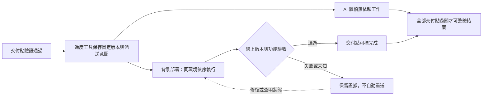

# 到交付點就部署，後續工作不停（2026-10-17）

階段、大功能、里程碑皆須交付，不等整個任務。Skill 定義何時交付；進度工具強制執行；背景作業負責部署及線上驗收；Stop Hook 補查整體結案。使用者已持續授權部署，完成必要測試後可直接部署，不必再次詢問；保留測試、驗收及其他花費、刪除限制。

## 何時讀、如何接入

規劃新工程任務、準備交付點或部署失敗時讀本頁。先在進度檔旁建同名 `*.delivery.json`，格式見 [範本](../templates/task.delivery.json)。這是輸入清單，不是部署成功證據。

- `project` 是工作區絕對路徑；`task` 與進度紀錄一致。每個 step 分類為 `stage`、`feature`、`milestone` 或 `internal`；最後一類只供分析／準備，必填理由。已登記的交付點不能刪除、改為內部步驟或換版本來躲過結案檢查。新增版本要新增交付點。
- 交付項的 `artifact`、`validation`、`authorization`、`deploy`、`readback` 都是 `{path,sha256}`。相對路徑以計畫所在目錄為準。產物是固定發布包，不是繼續變動的工作樹；工具保存快照。
- 驗證原件是 JSON：`version_sha256` 對應產物；非空 `checks` 各有 `name`、`result:pass`。
- 授權原件是 JSON：`authorized:true`、`project`、`environment`、`artifact_sha256`、`deploy`、`readback`、`source:{path,sha256}`。`source` 必須保存真正的使用者授權；部署使用者已持續授權，沿用該授權來源，不每次重問；仍須保存實際專案、環境與產物證據。監督者負責判讀授權範圍；工具只核資料一致，不能辨識偽造指令。
- 兩支腳本是可直接執行、無外部相對路徑依賴的固定腳本。部署腳本只發布 `CASH_DELIVERY_ARTIFACT`，不得重建其他版本；環境由 `CASH_DELIVERY_ENVIRONMENT` 提供。讀回腳本自行查服務及主要功能，stdout 僅輸出 JSON：`version_sha256`、`result:pass`、非空且全通過的 `checks`。不得直接回印 `CASH_DELIVERY_SHA256` 冒充線上讀回；測試假服務只能用於隔離測試。

## 強制行為

- 經原 `cash-rule-checkpoint` 寫 `VALIDATING` 且 `--check` 全為 pass，會先驗候選進度，再保存派送意圖與固定版本、自動啟動背景作業。返回後立即續做其他工作。
- `DONE` 必須已有交付成功證據；工具不代你等待。`COMPLETE` 核所有已登記交付點。內部步驟也須在計畫列出，不能漏填分類。
- 同環境用系統服務的前序關係排序；每版只有一個作業。單支腳本上限 1–900 秒、記憶體 1 GiB、CPU 半核心、輸出檔上限 16 MiB。部署不得在此重新編譯；大包先備好。
- 交付成功與失敗服務保留，供查明派送是否發生。紀錄在 `~/.local/state/cash-rule-delivery`。Stop Hook 看登記狀態，不靠回答文字；已標整體完成但仍未交付，持續拒絕，不因第三次而放行。正常進行中的部署不阻擋回合結束，也不阻擋其他步驟。

## 失敗與續接

工具回報作業目錄。用 `python3 ~/tools/cash_rule_delivery.py status <作業目錄>` 同時查紀錄與實際服務，不把「紀錄還在 running」當成服務仍在跑。

寫進度前後中斷、尚未派送或前序未知時，用 `submit <進度檔> --task T --step S` 續接。工具先查原作業；同次開機、確認服務不存在才首次派送。已啟動／成功／失敗者不自動重送。跨開機的未知狀態保留，先核實遠端狀態，不猜。

已失敗且服務已停止，先查明失敗原因並完成必要修復與測試，再將持續部署授權對應到本次作業並保存後執行 `retry <作業目錄> --authorization <JSON> --sha256 <指紋>`。授權含 `authorized:true`、`job:<作業目錄名>`、`source:{path,sha256}`；最多三次，各次保留舊證據。不得盲目重試；部署沿用持續授權，不必再次詢問。缺少發布資料或測試證據時補齊，不停止其他獨立工作。取消整個任務用原 CANCELLED，不能假報 COMPLETE。

## 邊界與舊相容檢查

未接專案發布腳本與授權，工具不能憑空部署，但會拒絕把交付點標完成。Skill 必須事先如實分類；相同作業系統帳號仍能改工具／證據，這不是防惡意攻擊的權限隔離。要抵抗刻意繞過，須由 AI 無寫入權限的發布系統持有授權與證據。

舊的回答文字／交付收據檢查保留，仍只核原件指紋，最多阻擋三次；它不是上述強制完成門檻。JSON 收據仍包含 `schema_version:1`、`cwd`、`session_id`、`units[]`，交付狀態及原件規格沿用既有 `delivery_check.py`，不拿文字代替線上驗收。

## 瀏覽器跨版驗證（2026-10-18）

發布前保存舊入口及其相依檔案清單；發布後用同一網址分別驗新版入口與保存的舊入口。可用瀏覽器攔截僅重放舊HTML以重現，資源必須實際向正式站載入；此方式不等於已測使用者原裝置，須明列限制。不得把重新下載的包雜湊或加版本查詢參數當作原網址可用的證據。入口須重新驗證，舊版本資源須維持可讀且內容不變；清理舊發布目錄前核對仍可取得。

`delivery.surface` 填 `browser`。部署讀回增加 `browser_upgrade`，四鍵 `current_entry`、`previous_entry`、`missing_asset_negative`、`cache_revalidation`，每值為 `{path,sha256}`。各原件有 `check`（同鍵）、`result:pass`、`version_sha256`，另保存實際資源狀態、瀏覽器畫面或失敗文字、HTTP快取規則。缺包反例的 pass 表示驗證確實辨識故障，不能把故障當作正常載入。`agents/guards/delivery_check.py` 在既有 Stop 檢查核原件與同版；Fluke 網站即使漏標 surface 仍強制要求。它不能證明手寫原件真實，監督者仍須親自執行並核對畫面。
